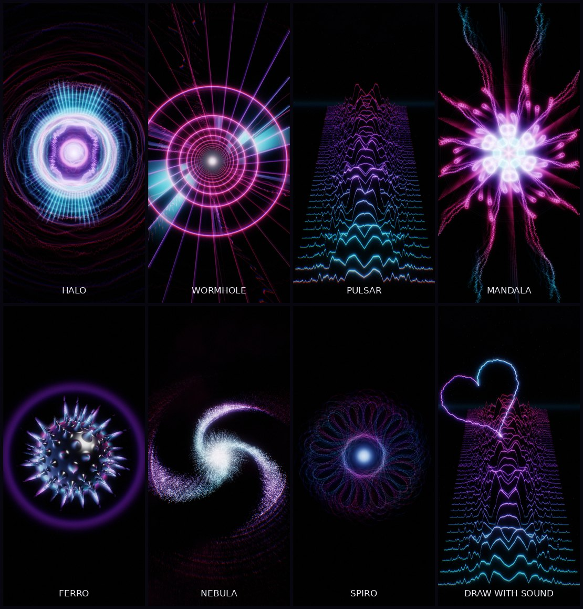
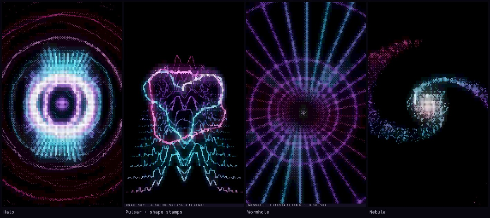

# TAV — Termux Audio Visualizer

Music turned into light on your phone. TAV listens to whatever is playing — Spotify, YouTube, a file —
and drives GPU shaders with it: rings that ripple out on every kick, a tunnel that speeds up with the
track, Joy Division ridgelines built from the spectrogram, a ferrofluid ball that grows spikes per
frequency. And you can draw on it: whatever shape you trace becomes a line made of the live sound wave.



There are two editions sharing one audio engine:

| | **Android app** (`android/`) | **Terminal** (`termux/`) |
|---|---|---|
| Reacts to the Spotify **app** | ✅ hooks the phone's output mix | — (Android won't let Termux hear other apps) |
| Reacts to Spotify **in Termux** (`ncspot`) | ✅ | ✅ |
| Plays + shows a music file | via any player | ✅ `tav song.mp3` |
| Renderer | OpenGL ES 3.0, bloom, feedback trails | braille dots + truecolor glow |
| Touch | tap = ripple, drag = draw with sound | tap = ripple, drag = draw with sound |

---

## Android app

### Install

1. On your phone, open the **[latest release](https://github.com/Christian-Ernst/TAV/releases/tag/latest)** and download **TAV.apk**.
2. Open it and allow installing from your browser when Android asks.
3. Start TAV, tap **Let it listen**, then play something in Spotify.

Or build it on the phone itself, in Termux, with one script:

```sh
pkg install git
git clone https://github.com/Christian-Ernst/TAV && cd TAV
bash setup.sh
```

`setup.sh` repairs a half-upgraded Termux (official mirror, discontinued packages, full upgrade),
installs the tools, offers to set up release signing, builds the APK and opens the installer, and
installs the terminal edition as `tav`. Run it again any time to update everything. To build by hand
instead: `pkg install openjdk-21 aapt2 d8 apksigner zip unzip`, then `android/build.sh` and
`termux-open android/build/TAV.apk`.

The first build downloads Android's framework stubs once (~64 MB) and creates a signing key for
your phone in `~/.config/tav/`.

### How it hears Spotify

TAV attaches Android's `Visualizer` effect to audio session 0, the phone's global output mix, so it sees
exactly what you hear from any app without that app's cooperation. Android puts this behind the
"record audio" permission. TAV only analyses the samples frame by frame; nothing is recorded, stored or sent.

If a phone's ROM blocks this (some do), TAV falls back to the microphone automatically. You can also pick
**Listen to → Microphone** yourself.

**What's playing:** Spotify keeps running as its own app. When the song changes, TAV shows the title and artist
(menu → **Song title → Always on screen** keeps them there) and can switch scenes with it. Choose
**Colours → Album** and grant notification access, and every scene is recoloured from the cover art.
Without notification access, switch on *Settings → Device Broadcast Status* in Spotify for title and artist.

**Playback controls:** previous, play/pause and next sit at the top of the menu, and the on-screen song title
works as a remote: swipe it left for the next track, right for the previous one, tap it to pause. They work
even without notification access, because TAV then sends ordinary media-button presses to the active player.

### Controls

| Gesture | Does |
|---|---|
| Tap | Ripple from that point; its rim is the live waveform |
| Drag | Draw a line the sound wave travels along |
| Two-finger swipe | Next / previous scene |
| Swipe the song title | Next (left) / previous (right) track |
| Tap the song title | Play / pause |
| Long-press or ☰ | Menu: playback controls, scenes, shape stamps, mirror (mandala) mode, colours, brightness, motion, equalizer, audio source, autopilot, song title, quality |

**Autopilot** (on by default) changes scenes when the track changes, when a drop hits, or every 45 s.
**Mirror** repeats everything you draw 2–12 times around the centre.
**Colours**: *Album* takes the colours from the cover art and keeps its tone (a dusty cover gives a dusty palette,
a neon cover a neon one), *Neon* to *Aurora* are presets, and *Custom* opens an editor for your own three colours. Tap a swatch, then drag Hue, Saturation and Brightness; the visuals change while
you drag, and TAV keeps the colours for next time. Tap *Custom* again to edit them.
**Brightness**: Dim, Soft, Normal (the default) or Bright. On an OLED screen in a dark room, try Soft or Dim.
**Equalizer** sets how hard the scenes react to the music, for every scene. *Flat* is the look before the
equalizer: each band is scaled to its own recent peak, so a quiet verse looks much like the chorus. *Punch*
(the default) keeps more of the loud-and-quiet difference and hits the beat harder. *Custom* opens seven
sliders: **Master** (how much everything moves), the four bands (**Bass**, **Low mids**, **High mids**,
**Treble**; each one's share of the motion), **Punch** (how much loud-and-quiet survives) and **Beat** (the
beat pulse and drop flash). The visuals change while you drag.
**Motion**: Full (the default) or Calm. Calm stops the beat pulses, beat ripples and drop flashes; the scenes still
move with the music. Use it if flashing lights bother you or you are sensitive to them.

### If the visuals don't move

* **Volume at zero:** some phones hand the visualizer silence when the media volume is muted. Turn it up a notch.
* **Phone blocks output capture:** a few ROMs refuse the global visualizer; TAV then switches to the microphone
  on its own and says so. Others hand it silence instead. If Spotify is playing while TAV hears nothing, it tells
  you to pick **Listen to → Microphone**; hold the phone near the speaker.
* **Album colours missing:** grant notification access (menu → Colours → Album), or switch on
  *Device Broadcast Status* in Spotify's settings for track names.
* **Stutters on an older phone:** menu → Quality → Battery. TAV also lowers its resolution by itself when frames run late, and raises it again once they run fast.

### Scenes

**Halo** — a plasma core, a waveform ring and spectral rays that run to the corners; every beat launches a
ripple, and a drop fires the rays and flares the core.
**Wormhole** — a neon tunnel flown at the speed of the music, its far end lost in fog; a drop twists it and
re-rolls the panels.
**Pulsar** — the spectrogram as receding ridgelines ("Unknown Pleasures") under an aurora; a drop lifts the
whole landscape.
**Mandala** — a kaleidoscope that folds over its own previous frame; a drop sucks the echoes in and, unless
Mirror fixes the symmetry, re-rolls the fold count.
**Ferro** — a raymarched ferrofluid sphere over a floor that mirrors it; each spike listens to its own
frequency and a drop bursts them.
**Nebula** — a 48 000-star galaxy laid along the long axis of the screen, whose rings breathe per band, with a
shockwave on every beat and a bigger one on every drop.
**Spiro** — spirograph lace etched with the waveform, one hue per strand, over a spectrogram curtain.

Every scene is composed for a phone held upright: the top and bottom carry haze, rings, sky or a floor in the
palette's own deep tone instead of black. On every drop the music clock surges, so all motion lurches forward
for a moment.

---

## Terminal edition (Termux)



```sh
pkg install git
git clone https://github.com/Christian-Ernst/TAV && cd TAV/termux
./install.sh
```

(`bash setup.sh` in the TAV folder installs this too, together with the Android app.)

```sh
tav song.mp3        # play a file and watch it
tav                 # visualize whatever Termux plays through PulseAudio
tav --mic           # listen through the microphone (grant Termux:API the mic permission first)
tav --help
```

**Spotify in the terminal:** `pkg install ncspot` (Spotify Premium), start `ncspot` in one Termux
session and `tav` in another. ncspot plays through PulseAudio, and `tav` listens to PulseAudio's monitor.

Keys: `space`/arrows switch scenes, `1`–`7` jump to one, `s` stamps a shape, `m` mirror mode, `c` clear,
`k` colours, `a` autopilot, `h` help, `q` quit. Tap the screen for ripples and drag to draw. Termux reports
finger drags as scrolling, which only moves in whole rows, so strokes with some up-down movement draw best;
`s` stamps complete shapes. Pinch-zoom Termux out for more resolution. If it stutters, try `--fps 20` or `--lite`.
If sound and picture drift apart in file mode, use `--delay MS`.

---

## Browser edition (`web/`)

The same shaders in WebGL2, driven by a synthesized demo track or any song you open. Serve the repository
root and open `/web/`:

```sh
python3 -m http.server 8000    # then visit http://localhost:8000/web/
```

Turn on GitHub Pages for the repository and it works at `https://<user>.github.io/TAV/web/` too.
Browsers can't hear other apps, so it can't follow Spotify; that's what the Android app is for.
Keys: arrows or `1`–`7` for scenes, `space` play/pause, `k` colours, `b` brightness, `m` mirror, `s` shape, `c` clear.

---

## How it works

```
samples ──► AudioAnalyzer ──► 512-bin log spectrum + peaks, triggered loop-seamless waveform,
            (FFT 1024, Hann)    spectrogram history, 4 auto-gained bands, beat pulse
                                (bass spectral flux vs. adaptive threshold), drops, music clock
                    │
                    ▼
   scene shader (reads its own last frame) → particles → your ripples & strokes
   → scene crossfade → dual-Kawase bloom → hue-preserving tone map, chromatic aberration on beats, grain
```

* `android/src/…/AudioAnalyzer.java`, `web/analyzer.js` and the analyzer in `termux/tav.c` are the same
  algorithm, so all editions react identically.
* Scenes are GLSL ES 3.00 files in `android/assets/shaders/`. The same files run in WebGL2
  (`web/engine.js`), which is how they were designed and screenshotted.
* Feedback warps are scaled by frame time, so 90/120 Hz screens look like 60 Hz ones.
  Resolution adapts when the GPU can't keep up.
* No Gradle and no libraries: `android/build.sh` drives `aapt2`, `javac`, `d8` and `apksigner`
  directly, which is why it also runs inside Termux.

### Signing

No signing key lives in this repository: a key anyone can download would let anyone ship an
"update" that silently inherits TAV's microphone and notification access.

**One-time setup (2 minutes, in Termux):** this makes a release key on your phone and gives it to GitHub
Actions as the `TAV_KEYSTORE_B64` and `TAV_KS_PASS` secrets, then starts a fresh build:

```sh
cd TAV && android/tools/setup-signing.sh     # or: bash setup.sh, which offers this step
```

It installs `gh` and a JDK if needed and asks you to log in to GitHub once. Afterwards every release and
every APK you build on the phone share that key, so updates install over each other. Uninstall the TAV
you have once before installing the first release signed with it. Back up `~/.config/tav/`: without the
key, a later release can't update the installed app.

Until the secrets exist, each CI release is signed with a one-off key (the release notes say so), and
`build.sh` signs with a key it creates once per device in `~/.config/tav/`.

### Checks

```sh
android/tools/check.sh   # every shader through glslangValidator + analyzer self-test (needs ANDROID_HOME)
android/build.sh         # builds android/build/TAV.apk
node web/tools/measure.js --track dense   # how blown out each scene is at a drop (headless Chromium + Playwright)
```

CI runs both, builds the terminal edition with gcc and clang, and publishes the APK as the
`latest` release on every push.
